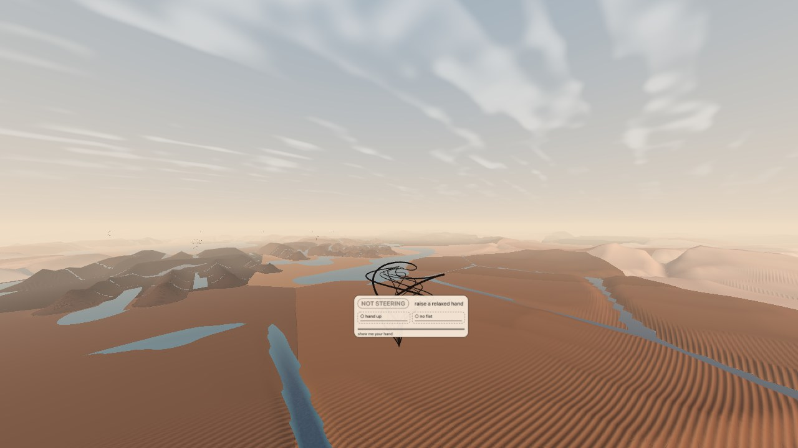

<h1 align="center">Palm Whorl Cities</h1>

<p align="center"><b>Every hand is a piece of the map.</b><br/>
Read your own hand, and it becomes a land: its lines are rivers, its fingertips are terraced print
hills. Lay it at the edge of a world made only of players' hands, then glide over all of them as a
creature of black ink.</p>

<p align="center">
  
</p>

<p align="center">
  <a href="https://hey-look-its-tim-dries.github.io/td-devpost-hackathon-meta/">Play it</a> ·
  <a href="https://start-developer-competition-26.devpost.com/">Meta VR Start Developer Competition 2026</a><br/>
  A mixed reality game for Meta Quest, hands only
</p>

## Project description

A palm already looks like a map. Its heart, head and life lines are rivers, the creases of the
fingers are canals, and the ridges of a fingerprint are the contour lines of a hill. Palm Whorl
Cities takes that literally, and makes one shared world out of it.

The world starts as the **First Ten**: ten founding Hands lying in a ring around the Source. There is
no other designed land. The world only grows when a player joins.

- **Read your hand.** In your own room, in passthrough, a card floats in front of you next to your
  real hand. You look at each fingertip and touch the pattern that matches (arch, tented arch, loop,
  whorl, pocket loop, double loop). You trace your heart, head and life lines on a drawn palm, pick
  a skin palette and get a name.
- **Lay your Hand.** The game finds three places on the frontier where your Hand fits against the
  Hands already there, and shows them as ink outlines on the land. Choose one, and your Hand rises
  out of the wilderness over eight seconds, rivers first.
- **Glide.** You are the Whorl, a creature of nine ink strands. Point where you want to fly: fingers
  up climbs, fingers down dives, and diving builds speed. Skim a ridge and you are flung forward.
- **Scribbles.** Every fingerprint hatches a scribble, a single tapered ink line that knots above its
  Hand. Your own five follow your Hand once it has risen.
- **Other players.** Whoever is in your room right now flies beside you as an ink creature, and a
  Hand laid by anyone, anywhere, rises in your world while you watch.

There is nothing to fail, no timer and no score. Your Hand stays where you laid it.

| Usual hand-tracking games | Palm Whorl Cities |
| --- | --- |
| Hands hold virtual tools | Your hand is the controller, the creature and the map |
| Levels are made by designers | Ten founders, then only players' Hands |
| The room is a backdrop | You compare your real hand with its map, in your room |
| Score and fail states | Calm: every river leads to another Hand |

### The first minutes

| | |
| --- | --- |
|  |  |
| The world is the title screen | You are the Whorl |
|  |  |
| Which pattern is on your thumb? | Trace your lines: they become rivers |
|  |  |
| A palette and a name | Three places where your Hand fits |

### In the headset

Seen through Meta's Quest 3 emulator (IWER). The card at the bottom of your view shows what your
hand is commanding:



## Hands first

Everything works with hands alone. Every action also has an easier alternative.

| Action | Hands | Alternative |
| --- | --- | --- |
| Pick a pattern, press a button | Touch the card with your index fingertip | Look at it and pinch |
| Trace a palm line | Drag your fingertip over the drawn palm | "Use the dotted guide" or "Use a typical palm" |
| Choose where your Hand goes | Look at an outline and pinch; pinch again to lay it | Keys 1 2 3 and Enter |
| Steer | Raise a relaxed open hand and point: your fingers are the arrow | Turn your head, or A D W S |

Quest hand tracking is steadiest at the wrist and knuckles, so steering reads the direction from
wrist to middle knuckle, never the fingertips. A hand only steers when it is raised, open and held
for 0.4 seconds, so a hand resting on your lap does nothing, and a small card fixed in your view
always shows which of those conditions is met. On a laptop a webcam can stand in for the headset's
hand tracking (MediaPipe, on the device).

## Your hand, not your data

Palms and fingerprints are biometric data, so the game is built so it never needs yours:

- You read your hand **by eye**. No camera looks at it. The game learns the pattern class you chose
  for each finger and the lines you drew.
- What is kept is map DNA: 44 bytes per fingertip and about 80 bytes for a palm. The print hills are
  regrown from the class and a fresh random seed, so real minutiae, the details that identify a
  person, never exist anywhere in the game.
- Skin colour is a palette you choose. It is never measured.
- Hand tracking is used live for interaction only. Nothing measured from your hand is stored, sent or
  used to shape a land, as Meta's hand-data policy requires.
- The shared map stores the DNA, where the Hand lies, its name, and the hash of a random device
  token. "Forget my Hand" removes it from the map and from the device.

## Components and tech

| Component | Role | Where |
| --- | --- | --- |
| three.js 0.186 + WebXR | Rendering, `immersive-ar` passthrough for the readout, hand tracking | [src/main.js](src/main.js) |
| Hand DNA | Packing a palm and five prints into a few bytes, and back | [src/hand/dna.js](src/hand/dna.js) |
| Hand builder | DNA to shape, handbits, rivers and terraces, baked in workers into arrays the GPU takes as they are | [src/hand/](src/hand/) |
| Terrain | One level-of-detail surface for every Hand and the endless skin wilderness, in one shader | [src/world/surface.js](src/world/surface.js), [src/world/wild.js](src/world/wild.js) |
| The atelier | The read-by-eye card: prints, traced lines, palette, name | [src/atelier/](src/atelier/) |
| Fit finder | Three places on the frontier where a new Hand fits, and how many rivers join | [src/world/fit.js](src/world/fit.js), [src/world/ghosts.js](src/world/ghosts.js) |
| Gestures | Palm frame, the raised-open-hand check, steering by pointing, the gesture card | [src/gesture.js](src/gesture.js), [src/gesturecard.js](src/gesturecard.js) |
| Flight | Glider physics: dives build speed, skimming gives a boost | [src/glide.js](src/glide.js) |
| Ink | The Whorl, the scribbles and other players, all ribbons in one draw call | [src/creature.js](src/creature.js), [src/scribble.js](src/scribble.js), [src/ink.js](src/ink.js) |
| Shared map | A Cloudflare Worker: one World (D1, one lay at a time, overlaps refused) and live Rooms of up to 200 players | [server/](server/), [src/net.js](src/net.js) |

No build step and no asset files: plain HTML and ES modules, served as they are.

## Setup

### Play on a Meta Quest

1. Open the **Meta Quest Browser** and go to https://hey-look-its-tim-dries.github.io/td-devpost-hackathon-meta/
2. Tap **Enter in headset** and allow hand tracking.
3. Read your hand on the card, lay it into the world, then raise a hand and point where you want to fly.

### Run it locally

Prerequisites: Python 3 and a recent Chrome. Node 20+ only for the tests and the server.

```bash
git clone https://github.com/hey-look-its-tim-dries/td-devpost-hackathon-meta.git
cd td-devpost-hackathon-meta
python3 serve.py
```

Open http://localhost:8130/ and choose **Preview in the browser**. Click the card to read your hand,
press 1, 2 or 3 and Enter to lay it, then steer with A D (turn) and W S (climb and dive); drag to
look around. **Use my webcam as hands** steers with your real hand instead.

### Try the headset flow without a headset

Open http://localhost:8130/?emulate for Meta's IWER emulator with a virtual Quest 3 and tracked
hands. To test on your own Quest from your laptop, connect it over USB, run
`adb reverse tcp:8130 tcp:8130`, then open http://localhost:8130/ in the Quest Browser.

### The shared map (server)

The world's Hands live on a Cloudflare Worker with D1 and Durable Objects, in `server/`. Locally:

```bash
cd server && npm install && npm run seed && npm run dev
```

That serves the map on http://localhost:8787; open the game with `?api=http://localhost:8787`.
Without a server the game plays alone with the First Ten and your own Hand, and sends your Hand
the next time the map can be reached. To deploy: `npx wrangler login`,
`npx wrangler d1 create pwc --location weur`, put the id in `server/wrangler.toml`, then
`npx wrangler d1 execute pwc --remote --file=schema.sql`,
`node seed.mjs > seed.sql && npx wrangler d1 execute pwc --remote --file=seed.sql` and
`npm run deploy`, and set `API` in `src/net.js` to the Worker's URL.

### Tests

```bash
node --test tests/*.test.mjs   # the server tests run when a server answers on :8787 (SERVER=1 starts one)
node tests/m3.mjs              # two browsers on one map: needs serve.py on :8130 and the server on :8787
```

### Handy URL parameters

| Parameter | Effect |
| --- | --- |
| `?play` | Skip the title and start the browser preview |
| `?webcam` | Start with the webcam as hands |
| `?auto` | A slow circle with nobody steering (`?auto=dive` dives), for screenshots |
| `?at=0,600,7000&pitch=-0.3` | Start somewhere else, looking up or down |
| `?api=http://localhost:8787` | Use this server for the shared map |
| `?emulate` | Quest 3 emulation with IWER (`&device=glasses` for the Meta VR Glasses, `&nodevui` hides its panel) |

## Competition fit

- **Track:** Gaming. **Division:** New Experience, conceived and built from 24 September 2026.
- **Hands first:** the whole game runs without ever pairing a controller.
- **Purposeful passthrough:** you read your hand in your own room, with your real hand next to its
  map. Comparing the two is the point of that step. The world itself is immersive.
- **Headset only:** no phone, no camera and no account are needed.
- **Boldest original concept:** a world map made of nothing but its players' hands.

## What's next

- An optional phone page that reads your real palm lines and print classes, deletes the photo, and
  sends only the map DNA
- An atlas you open on your own palm: chart handbits, follow a river to its neighbours
- Walking a print hill at human scale, along the furrows between its ridges
