<h1 align="center">Palm Whorl Cities</h1>

<p align="center"><b>Every hand is a piece of the map.</b><br/>
Read your own hand, and it becomes a land: its lines are rivers, its fingertips are terraced print
hills. Lay it at the edge of a world made only of players' hands, then glide over all of them as a
creature of black ink.</p>

<p align="center">
  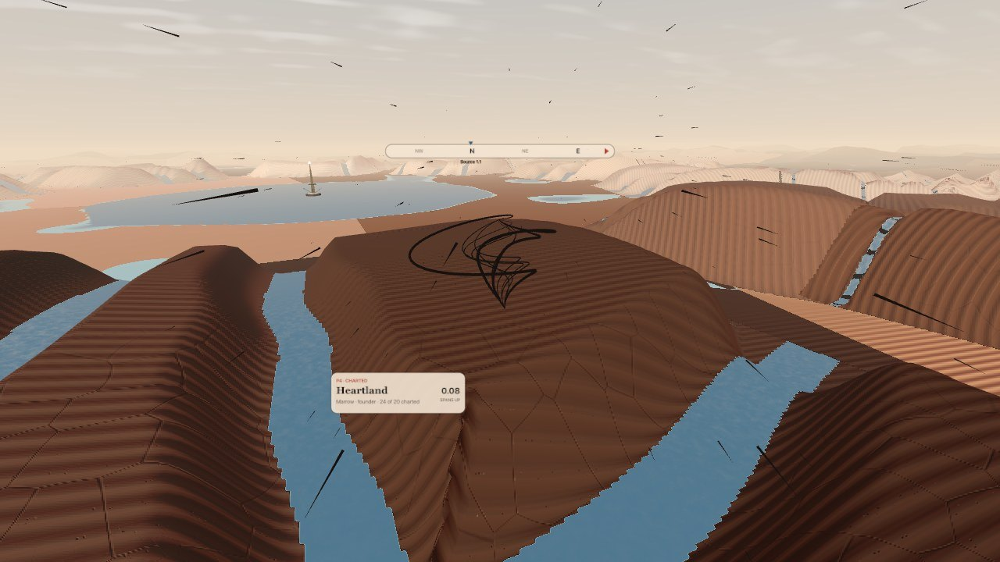
</p>

<p align="center">
  <a href="https://hey-look-its-tim-dries.github.io/td-devpost-hackathon-meta/">Play it</a> ·
  <a href="https://start-developer-competition-26.devpost.com/">Meta VR Start Developer Competition 2026</a><br/>
  A mixed reality game for Meta Quest, hands only
</p>

## Bloom: the garden game

On top of the flying, everyone gardens the desert together.

- **Collect:** fly through the swirls of seed on the wind. Each cloud is one species out of 688 real ones
  (259 flowers, 144 trees, and the birds, insects, fish and animals that follow them). New finds go into your herbarium.
- **Build:** hold **Space** (in the headset: hold a right-hand pinch) low over a Hand to sow. You slow down while you sow.
  **Q / E** (left-hand pinch) picks the seed. Every species has one of three looks: pixel art, painted, or 3D.
  Pixel species also lay a mosaic tile on the sand, snapped to a grid, so fields of them join into pictures.
- **Cultivate:** skim a river to fill your five pours of water, then fly low over groves to grow them (four stages).
  Anyone can water anyone's grove. Planting in the right habitat (dune, river bank, ridge) and mixing kinds scores more.
- **Grow:** a handbit is a plot of up to 80 groves. Its bloom has four levels; insects come first, then birds and fish,
  then animals, and the rarest only to a full bloom. Your whorl grows more strands with your gardener level, splits in
  two at full speed, and wears the flowers you planted most. Other players see them too.
- **Destroy:** groves nobody tends dry out after 36 hours and die after 96. **X** clears a grove: your own, any on your
  own Hand, or anyone's once it is dead (the compost gives two seeds back).
- **Together:** groves are on the shared map and appear live for everyone. Planting while your whorl is braided with
  another player's makes a double grove. Every four minutes one golden seed appears for the whole world, marked on
  every compass: the first to reach it wins a legendary species. The HUD shows who is flying, a radar with other
  players, seed clouds and blooming plots, and the top gardeners.

- **Hyper sow:** watering and gathering charge it. **F** (hold a left pinch for a second) gives ten seconds in which
  single plants fall along your path, free, 14 m apart: you draw with flowers. Pixel kinds lay 30 m tiles.
- **Sowing by hand:** sweep an open hand to scatter five groves to that side, throw it forward to cast them far ahead,
  press a flat palm down to pour water over the groves around you. On keys: **Z C** scatter, **R** cast, **T** pour.
- **I am what I have sown:** your whorl wears your whole sowing history as a bouquet, in order from head (first sown)
  to tail; what you sowed most has more and larger flowers; a day's plantings share strands. Others see it too.
- **Sandstorm:** every ten minutes a wall of dust crosses the world for four. Groves under its path are parched until
  someone waters them. It shows on the compass, the radar and the atlas, and is the same storm for every player.
- **Atlas:** the new Garden tab is your herbarium (every species by kind, found ones in colour, tap one you carry to
  sow it); the World map has a bloom layer with every blooming plot and the storm.

### Mushrooms and the foxfire

Fungi feed on what died: every dead grove grows wild mushrooms, and 24 real species (several of them truly
bioluminescent) are in the index to plant yourself. Fly low through a mushroom and you eat it. For 25 seconds
the world turns to **foxfire**, a second look laid over the calm one (nothing is replaced): dark land drawn in
contour and grid light, a striped sun, stars, neon rivers, plants dark with glowing edges, violet HUD panels,
and on a screen a bloom. You fly a third faster, everything you earn counts double, and openly licensed
synthwave plays (`assets/music/CREDITS.md`; **N** mutes). Each further mushroom chains: more time, a higher
multiplier. You get two spores of what you ate. `?fox` holds the look on, for screenshots.
The calm look before this was added is kept as the tag `look-desert-ink`.

### Gnomes

About four mushrooms in ten house a gnome (`assets/gnome.glb`, built by `tools/blender/gnome.py`, posed in code).
Who lives where, its name, its hat and what it is doing right now come from the mushroom and the clock, so
every player sees the same gnome asleep on the same cap, pottering about, or out riding the animals.

- Fly over one low and it **waves and shouts**. Dive past at full speed and it shakes its fists: you annoyed it.
- Pass low at ordinary speed and it **jumps and grabs your whorl** (three at most). Other players see your
  gnomes hanging on, and you see theirs.
- A gnome on board has a **side quest** (ten kinds: take it to the Source, to a far Hand or a distant cousin,
  eat a mushroom with it, sow, water, go faster, go higher, catch a seed cloud, skim a river). Three minutes.
- Do it and the gnome **joins your team** and gives you seeds. Another gardener's gnome first wavers, then
  **converts**; annoy another gardener's gnome often enough and it deserts them. The HUD counts your team
  and your converted gnomes; the map keeps the teams.
- **G** sets down the gnome that grabbed on last. Over water it gets a ducking and is cross with you.

### How the garden is kept

- Groves are rows in the map's database, indexed by Hand and plot. A plot holds 400 units (a grove 5, a hyper-sown
  plant 1), so a Hand holds at most 34 x 400 units, and the game reads the garden **Hand by Hand as you come near**:
  what a player downloads does not grow with the size of the world. Live changes arrive through the room.
- Your pouch (seeds, herbarium, sowing log) is kept on your device and on the map, by device token, and comes back
  after a cleared browser. Signed in with Facebook, all your devices share one pouch.
- Not done yet: all writes still go through one Durable Object (the World). Past a few hundred plantings a second
  that needs one object per Hand.

### Putting this version live

The live map needs the garden's tables before the new Worker runs (both commands in `server/`; the schema only adds
tables, it changes nothing that is there):

```bash
npx wrangler d1 execute pwc --remote --file=schema.sql
```

```bash
npx wrangler deploy
```

Then merge `m7-bloom` into `main` and push, so Pages serves the game that talks to it.

### Signing in with Facebook (optional; guests keep playing by device)

The code is in place and off until an App ID is set. The owner does this once:

1. At developers.facebook.com create an app with the "Authenticate and request data from users with Facebook Login" use case.
2. Basic settings: app domain `hey-look-its-tim-dries.github.io`; privacy policy URL and data deletion instructions
   URL: `https://hey-look-its-tim-dries.github.io/td-devpost-hackathon-meta/privacy.html`.
3. Facebook Login settings: valid OAuth redirect URI `https://hey-look-its-tim-dries.github.io/td-devpost-hackathon-meta/`.
4. Switch `public_profile` to Advanced Access and set the app Live (otherwise only the app's own testers can sign in).
5. Put the App ID in `src/config.js` and in `server/wrangler.toml` (`FB_APP_ID`), run
   `npx wrangler secret put FB_APP_SECRET` in `server/`, deploy.

The game asks for the public profile only and keeps a hash of the app-scoped user id, nothing else. Meta offers no
sign-in with the headset's own Meta account to a page opened by URL (only to apps installed from the Horizon Store);
the VR glasses run the same OS and accounts as Quest.

Checks: `node tests/bloom.mjs` (two browsers sow, see, water and clear) and `node tools/bloom-look.mjs <dir>` for screenshots.
Flower art from other makers is in `assets/flora` with its licences in `assets/flora/CREDITS.md`.

## Project description

A palm already looks like a map. Its heart, head and life lines are rivers, the creases of the
fingers are canals, and the ridges of a fingerprint are the contour lines of a hill. Palm Whorl
Cities takes that literally, and makes one shared world out of it.

The world starts as the **First Ten**: ten founding Hands lying in a ring around the Source. There is
no other designed land. The world only grows when a player joins.

- **Read your hand.** In your own room, in passthrough, a card floats in front of you next to your
  real hand. Read it by eye (look at each fingertip and touch the pattern that matches, trace your
  heart, head and life lines on a drawn palm), or let your phone read it: it photographs your palm
  and fingertips, reads the lines and patterns, deletes the photos and sends only the map DNA.
- **Lay your Hand.** The game finds three places on the frontier where your Hand fits against the
  Hands already there, and shows them as ink outlines on the land. Choose one, and your Hand rises
  out of the wilderness over eight seconds, rivers first.
- **Glide.** You are the Whorl, a creature of nine ink strands. Point where you want to fly: fingers
  up climbs, fingers down dives, and diving builds speed. Skim a ridge and you are flung forward.
- **Scribbles.** Every fingerprint hatches a scribble, a single tapered ink line that knots above its
  Hand. Your own five follow your Hand once it has risen.
- **Chart the world.** Every handbit you have not seen is a parchment blank; fly low over it and the
  ink spreads in. Chart all of a Hand and it is sealed with a red stamp.
- **The atlas.** Turn your left palm up and the map of the whole world opens above it: every Hand,
  its rivers and names, who is flying. Pin a place, fly there, name your handbits, be the first to
  name a summit, give a handbit to the Community Hand, replay the world's history, print a postcard.
- **Other players.** Up to 200 players share a room: their names float over their creatures, and when
  you meet one your swarms braid for a moment. A Hand laid by anyone, anywhere, rises in your world
  while you watch.
- **The Community Hand.** At the Source, under the gilt spire, everyone builds one hand together, a
  handbit each. When all 22 are given it is sealed, for everyone, and the next one begins.

There is nothing to fail, no timer and no score. Your Hand stays where you laid it.

| Usual hand-tracking games | Palm Whorl Cities |
| --- | --- |
| Hands hold virtual tools | Your hand is the controller, the creature and the map |
| Levels are made by designers | Ten founders, then only players' Hands |
| The room is a backdrop | You compare your real hand with its map, in your room |
| Score and fail states | Calm: every river leads to another Hand |

### The first minutes

| | |
| --- | --- |
| 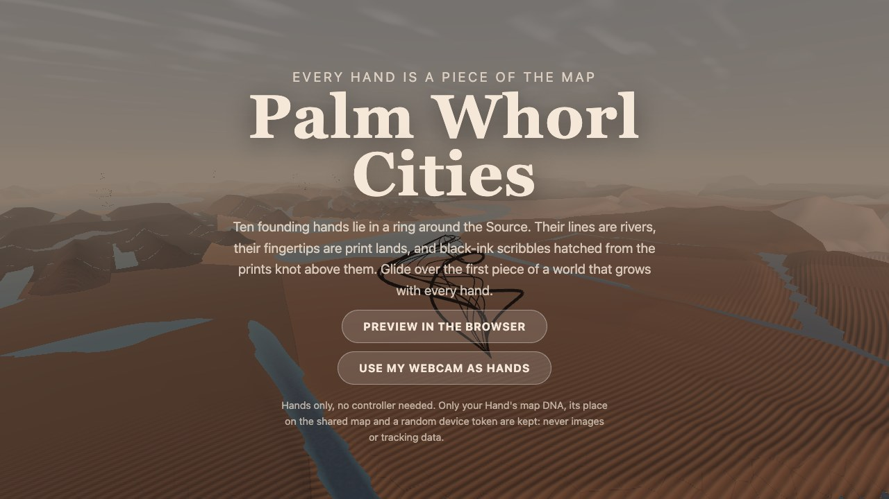 | 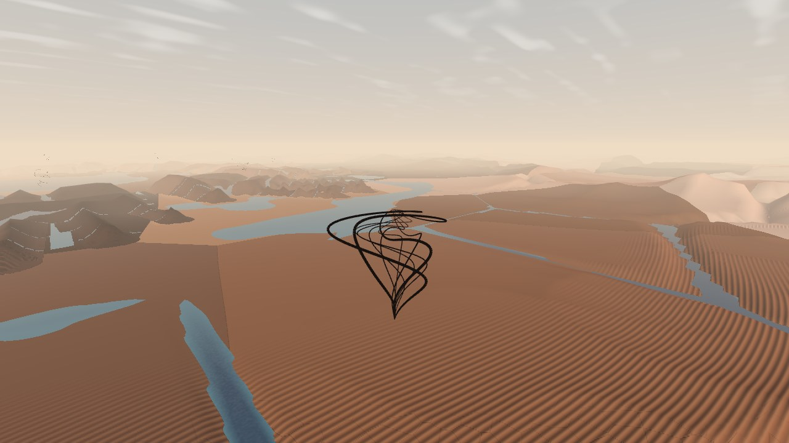 |
| The world is the title screen | You are the Whorl |
| 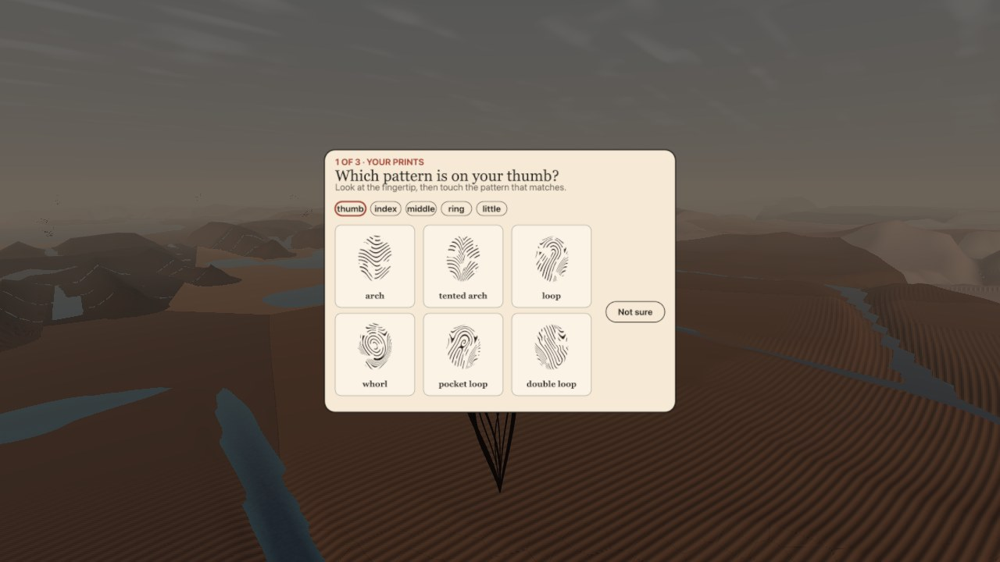 | 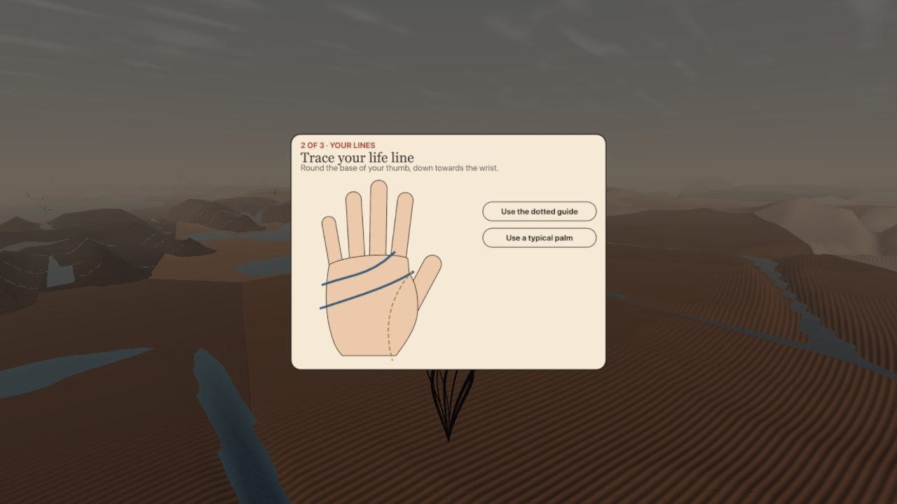 |
| Which pattern is on your thumb? | Trace your lines: they become rivers |
| 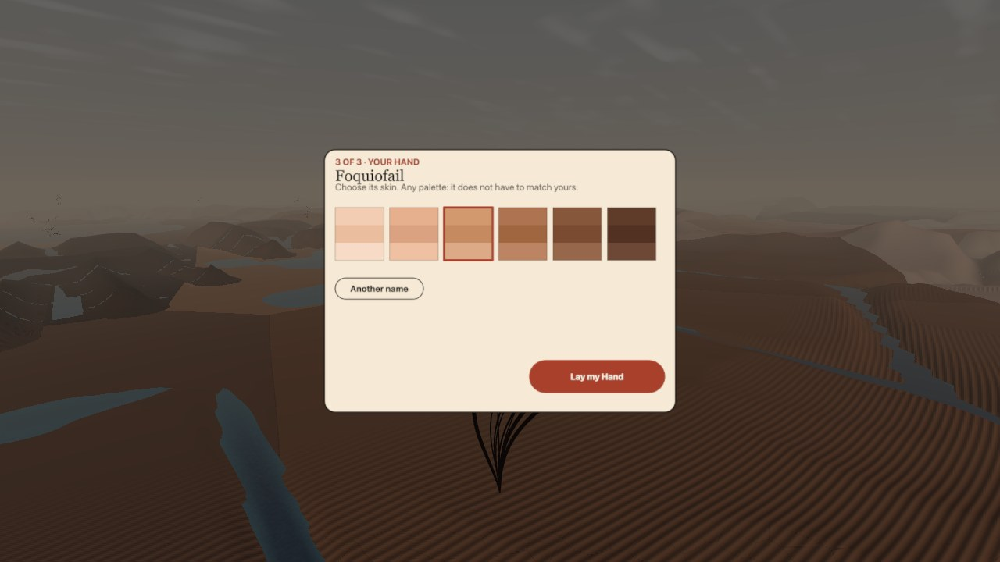 | 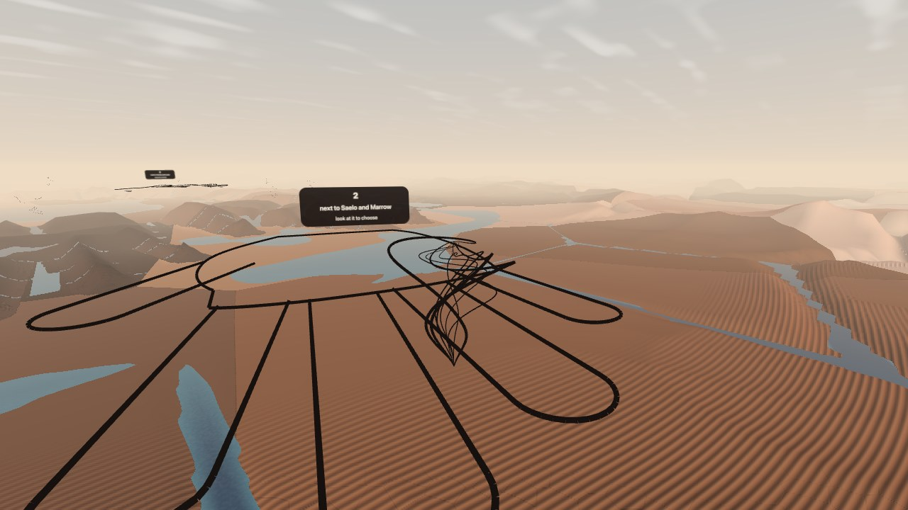 |
| A palette and a name | Three places where your Hand fits |

### The atlas and the shared world

| | |
| --- | --- |
| 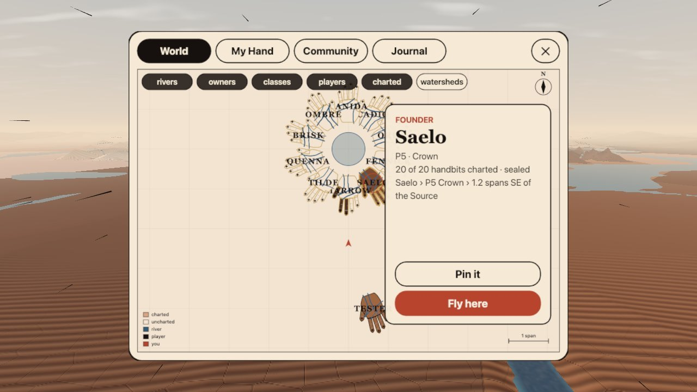 | 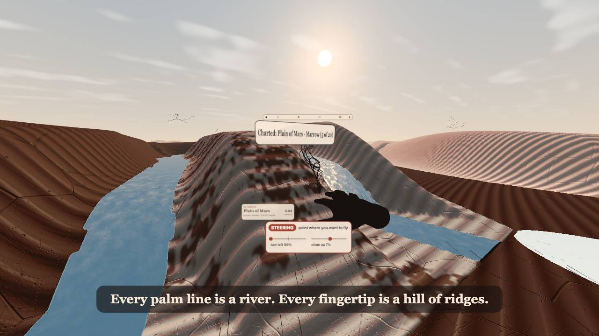 |
| The atlas: inspect, pin, fly there | Charting: fly low and the ink spreads in |
| 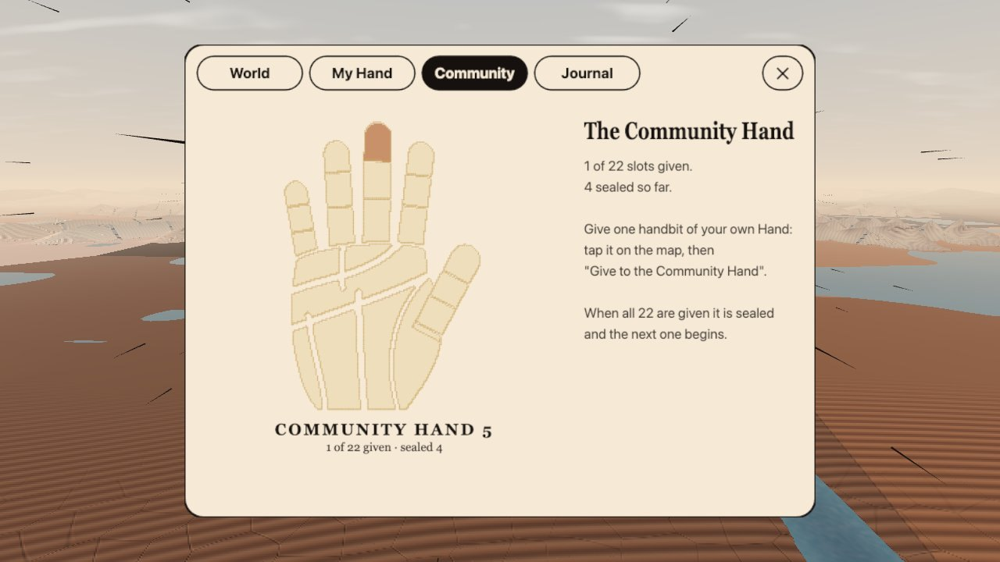 | 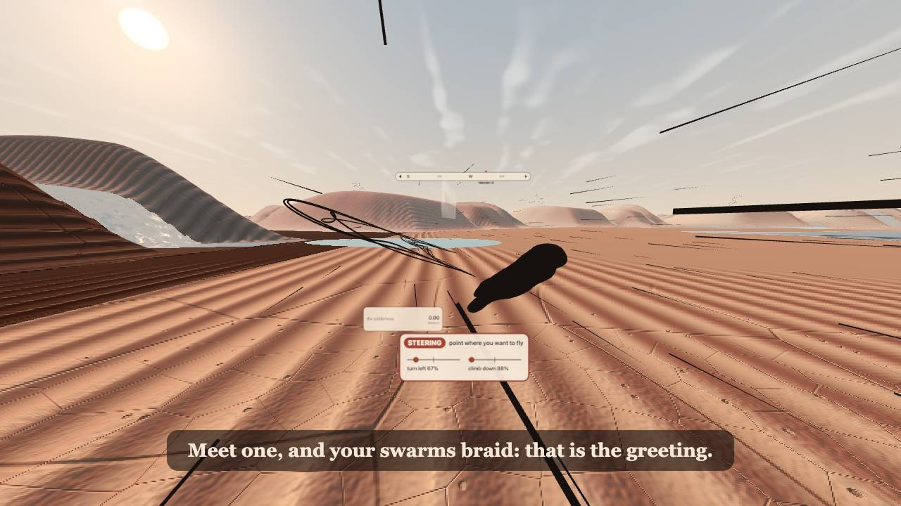 |
| The Community Hand, a handbit each | Meet someone and your swarms braid |
| 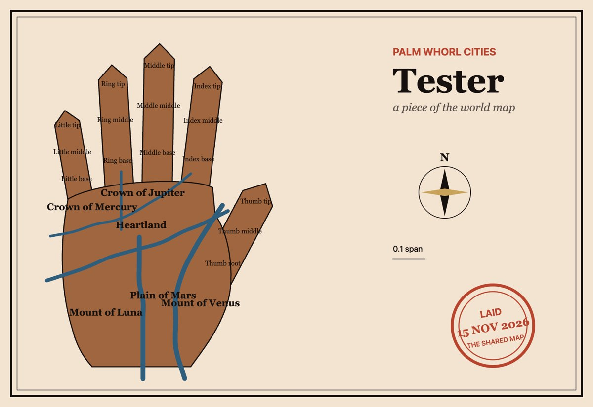 | 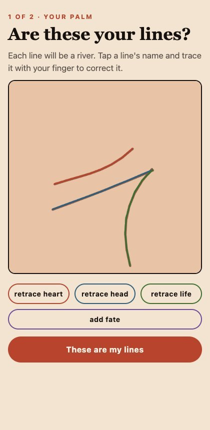 |
| Your postcard | Your phone reads your palm lines |
| 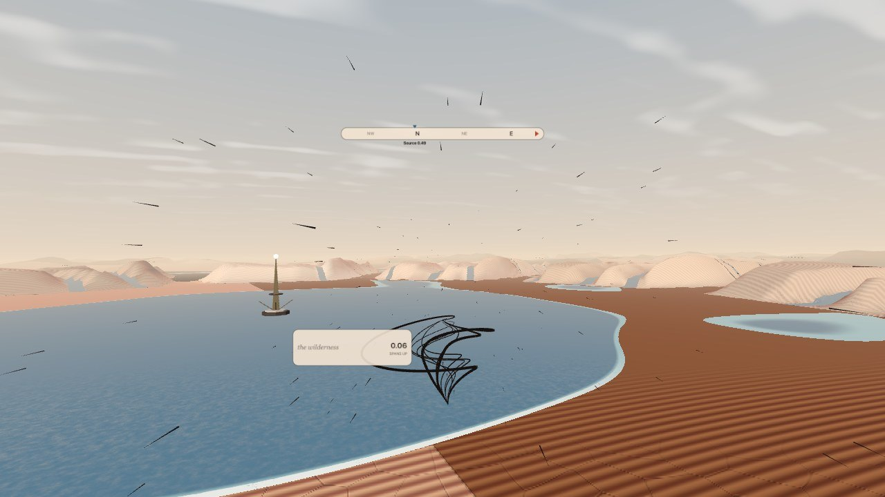 |  |
| The Source, made in Blender | Every palm line is a river |

### In the headset

Seen through Meta's Quest 3 emulator (IWER). The card at the bottom of your view shows what your
hand is commanding:


## Hands first

Everything works with hands alone. Every action also has an easier alternative.

| Action | Hands | Alternative |
| --- | --- | --- |
| Pick a pattern, press a button | Touch the card with your index fingertip | Look at it and pinch |
| Trace a palm line | Drag your fingertip over the drawn palm | "Use the dotted guide" or "Use a typical palm" |
| Choose where your Hand goes | Look at an outline and pinch; pinch again to lay it | Keys 1 2 3 and Enter |
| Steer | Raise a relaxed open hand and point: your fingers are the arrow | Turn your head, or A D W S |
| Lay your Hand | Palm down over an outline holds it; press 8 cm lower to lay it | Look and pinch twice |
| Open the atlas | Turn your left palm up; it follows your palm, turn it down to close | M |
| Use the atlas | Touch it with your right fingertip, drag to pan | Look and pinch; mouse and wheel |

Quest hand tracking is steadiest at the wrist and knuckles, so steering reads the direction from
wrist to middle knuckle, never the fingertips. A hand only steers when it is raised, open and held
for 0.4 seconds, so a hand resting on your lap does nothing, and a small card fixed in your view
always shows which of those conditions is met. On a laptop a webcam can stand in for the headset's
hand tracking (MediaPipe, on the device).

## Your hand, not your data

Palms and fingerprints are biometric data, so the game is built so it never needs yours:

- You read your hand **by eye** (no camera at all), or your **phone** reads it: the photos are read in
  the phone's browser and never leave it. Only the lines and patterns it found go on, shuffled by one
  step each. The camera route is 16 and over; anyone can read by eye.
- What is kept is map DNA: 44 bytes per fingertip and about 80 bytes for a palm. The print hills are
  regrown from the class and a fresh random seed, so real minutiae, the details that identify a
  person, never exist anywhere in the game.
- Skin colour is a palette you choose. It is never measured.
- Hand tracking is used live for interaction only. Nothing measured from your hand is stored, sent or
  used to shape a land, as Meta's hand-data policy requires.
- The shared map stores the DNA, where the Hand lies, its name, the names you give places, your gift
  to the Community Hand, and the hash of a random device token. "Export my data" downloads all of it;
  "Forget my Hand" removes it from the map and from the device, with your charting and pins.

## Components and tech

| Component | Role | Where |
| --- | --- | --- |
| three.js 0.186 + WebXR | Rendering, `immersive-ar` passthrough for the readout, hand tracking | [src/main.js](src/main.js) |
| Hand DNA | Packing a palm and five prints into a few bytes, and back | [src/hand/dna.js](src/hand/dna.js) |
| Hand builder | DNA to shape, handbits, rivers and terraces, baked in workers into arrays the GPU takes as they are | [src/hand/](src/hand/) |
| Terrain | One level-of-detail surface for every Hand and the endless skin wilderness, in one shader | [src/world/surface.js](src/world/surface.js), [src/world/wild.js](src/world/wild.js) |
| The atelier | The read-by-eye card: prints, traced lines, palette, name | [src/atelier/](src/atelier/) |
| Fit finder | Three places on the frontier where a new Hand fits, and how many rivers join | [src/world/fit.js](src/world/fit.js), [src/world/ghosts.js](src/world/ghosts.js) |
| Gestures | Palm frame, the raised-open-hand check, steering by pointing, the gesture card | [src/gesture.js](src/gesture.js), [src/gesturecard.js](src/gesturecard.js) |
| Flight | Glider physics: dives build speed, skimming gives a boost | [src/glide.js](src/glide.js) |
| Ink | The Whorl, the scribbles and other players, all ribbons in one draw call | [src/creature.js](src/creature.js), [src/scribble.js](src/scribble.js), [src/ink.js](src/ink.js) |
| Shared map | A Cloudflare Worker: one World (D1, one lay at a time, overlaps refused; names, the Community Hand, the journal, watersheds, the pairing relay) and live Rooms of up to 200 players (poses, names) | [server/](server/), [src/net.js](src/net.js) |
| Charting and the HUD | Which handbit lies under you, charting and seals, a compass ribbon and place card | [src/world/where.js](src/world/where.js), [src/world/chart.js](src/world/chart.js), [src/hud.js](src/hud.js) |
| The atlas | A cartographer's map of the world on a card that follows your palm; pins, Fly here, naming, the journal, postcards | [src/atlas/](src/atlas/), [src/autopilot.js](src/autopilot.js), [src/postcard.js](src/postcard.js) |
| Players together | Name tags, the greeting braid, the Community Hand | [src/labels.js](src/labels.js), [src/braid.js](src/braid.js), [src/community-art.js](src/community-art.js) |
| The phone | Palm lines from a valley map and a best path near each template line; print classes from the ridge orientation field; pairing | [phone.html](phone.html), [src/phone/](src/phone/) |
| The Source | A gilt spire built by a Blender script, exported as glTF | [tools/blender/source.py](tools/blender/source.py), [src/world/props.js](src/world/props.js) |

No build step and no asset files: plain HTML and ES modules, served as they are.

## Setup

### Play on a Meta Quest

1. Open the **Meta Quest Browser** and go to https://hey-look-its-tim-dries.github.io/td-devpost-hackathon-meta/
2. Tap **Enter in headset** and allow hand tracking.
3. Read your hand on the card, lay it into the world, then raise a hand and point where you want to fly.

### Run it locally

Prerequisites: Python 3 and a recent Chrome. Node 20+ only for the tests and the server.

```bash
git clone https://github.com/hey-look-its-tim-dries/td-devpost-hackathon-meta.git
cd td-devpost-hackathon-meta
python3 serve.py
```

Open http://localhost:8130/ and choose **Preview in the browser**. Click the card to read your hand,
press 1, 2 or 3 and Enter to lay it, then steer with A D (turn) and W S (climb and dive); drag to
look around. **M** opens the atlas. **Use my webcam as hands** steers with your real hand instead.

### The phone companion

On the card in the headset choose **Use my phone**, then scan the QR code (or open
`phone.html` and type the six-letter code). The phone page needs the shared map.

### Rebuild the Source in Blender

```bash
blender -b -P tools/blender/source.py -- assets/source.glb
```

### Try the headset flow without a headset

Open http://localhost:8130/?emulate for Meta's IWER emulator with a virtual Quest 3 and tracked
hands. To test on your own Quest from your laptop, connect it over USB, run
`adb reverse tcp:8130 tcp:8130`, then open http://localhost:8130/ in the Quest Browser.

### The shared map (server)

The world's Hands live on a Cloudflare Worker with D1 and Durable Objects, in `server/`. Locally:

```bash
cd server && npm install && npm run seed && npm run dev
```

That serves the map on http://localhost:8787; open the game with `?api=http://localhost:8787`.
Without a server the game plays alone with the First Ten and your own Hand, and sends your Hand
the next time the map can be reached. To deploy: `npx wrangler login`,
`npx wrangler d1 create pwc --location weur`, put the id in `server/wrangler.toml`, then
`npx wrangler d1 execute pwc --remote --file=schema.sql`,
`node seed.mjs > seed.sql && npx wrangler d1 execute pwc --remote --file=seed.sql` and
`npm run deploy`, and set `API` in `src/net.js` to the Worker's URL.

### Tests

```bash
node --test tests/*.test.mjs   # the server tests run when a server answers on :8787 (SERVER=1 starts one)
node tests/m3.mjs              # two browsers on one map: needs serve.py on :8130 and the server on :8787
node tests/phone.mjs           # the phone companion end to end, on generated images: same servers
node tools/film.mjs            # records the demo film in the emulator (media/), with a second player
```

### Handy URL parameters

| Parameter | Effect |
| --- | --- |
| `?play` | Skip the title and start the browser preview |
| `?webcam` | Start with the webcam as hands |
| `?auto` | A slow circle with nobody steering (`?auto=dive` dives), for screenshots |
| `?at=0,600,7000&pitch=-0.3` | Start somewhere else, looking up or down |
| `?api=http://localhost:8787` | Use this server for the shared map |
| `?emulate` | Quest 3 emulation with IWER (`&device=glasses` for the Meta VR Glasses, `&nodevui` hides its panel, `&room=` another scanned room) |
| `?go=<handId>.<code>` | Open flying to a place (the atlas's addresses) |
| `?calm` | Reduced motion: no braiding |
| `?perf` | Frame rate, draw calls and terrain patches in a corner |

## Competition fit

- **Track:** Gaming. **Division:** New Experience, conceived and built from 24 September 2026.
- **Hands first:** the whole game runs without ever pairing a controller.
- **Purposeful passthrough:** you read your hand in your own room, with your real hand next to its
  map. Comparing the two is the point of that step. The world itself is immersive.
- **Headset only:** no phone, no camera and no account are needed; the phone is an optional extra.
- **Multiplayer:** live rooms of up to 200, names, the greeting, a shared world map and a Community Hand.
- **Boldest original concept:** a world map made of nothing but its players' hands.

## What's next

- Walking a print hill at human scale, along the furrows between its ridges
- The headset's own cameras as a third way to read a palm, where the Quest Browser allows it
- Sound again, made for the shared world: every confluence and seal a chord
